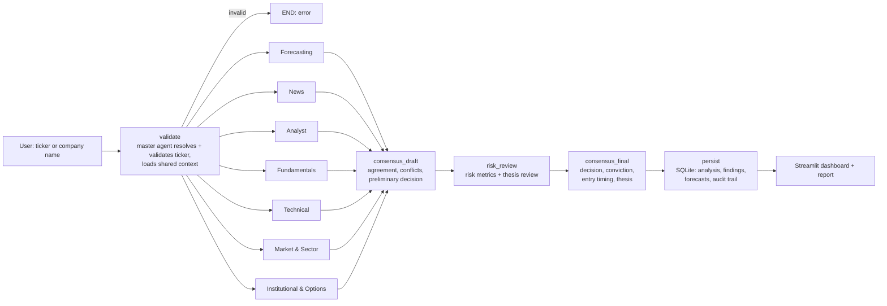

# StockIntel: Multi-Agent Stock Research Platform — Architecture

StockIntel is a decision-support system, not a chatbot. You give it a ticker. Nine specialized
agents each retrieve their own data, run their own analysis and return a typed JSON finding. A master
agent then reconciles those findings into one recommendation that you can audit.

> **Not financial advice.** Everything the platform produces is research output for decision support.

---

## 1. Workflow



* Orchestration uses **LangGraph** (`stockintel/orchestration/graph.py`). The seven research agents run as
  parallel branches of one graph superstep. Each writes into `state["findings"]` through a merge reducer.
* **Shared context.** The validate node fetches what several agents need: five years of daily prices, the
  company profile, and benchmark prices. It fetches them once and puts them in the graph state, so agents
  don't repeat the same downloads.
* Every node also appends to `state["audit"]`, a reducer list with an entry for each start, finish, warning
  and error. That list is persisted as the audit trail.

## 2. Agent contract

Every agent subclasses `BaseAgent` (`stockintel/agents/base.py`) and lives in its own package:

```
stockintel/agents/<name>/
    agent.py    # data retrieval + analysis; returns the finding
    prompts.py  # LLM system/user prompts (if the agent uses an LLM)
    schema.py   # Pydantic output schema (subclass of AgentFinding)
```

Every finding has the same envelope (`stockintel/schemas/common.py`):

| Field | Meaning |
|---|---|
| `agent`, `ticker`, `generated_at` | Identity and timestamp |
| `status` | `ok` / `partial` / `unavailable` / `error` |
| `signal` | Directional view in [-1, 1] (bearish to bullish) |
| `confidence` | 0–1. How much the agent trusts its own view, given data coverage and quality |
| `summary`, `key_points`, `risks` | Human-readable findings |
| `sources[]` | Each source has a name, URL, `retrieved_at`, `published_at`, `kind` and a `delayed` flag |
| `data_as_of` | Freshness of the underlying data |
| `unavailable[]`, `warnings[]` | What could not be retrieved, stated explicitly instead of guessed |
| `data` | Agent-specific typed payload |

## 3. Agents

| # | Agent | Retrieves | Computes | LLM use |
|---|---|---|---|---|
| 1 | **Forecasting** | Daily OHLCV (shared) | Drift/GBM baseline, ARIMA, XGBoost, LightGBM, Prophet\*, LSTM\* · walk-forward backtest for each model and horizon · skill-weighted ensemble · calibrated 80/95% intervals · bull/base/bear · support/resistance | none (fully quantitative) |
| 2 | **News** | yfinance news, plus optional Finnhub/NewsAPI, plus optional Claude web search | Deduplication, category, sentiment, impact, confirmed vs speculation, catalysts | Classifies only items that were actually retrieved, referenced by ID. It never invents URLs |
| 3 | **Analyst** | yfinance price targets, recommendation counts, upgrades/downgrades | Mean/median/high/low vs price, implied upside, 90-day revision trend, notable changes | none |
| 4 | **Fundamentals** | yfinance info, statements (annual and quarterly), peers | Growth, margins, FCF, leverage, valuation multiples vs peer median, red flags, whether valuation is justified | none |
| 5 | **Technical** | OHLCV (shared) | RSI, MACD, SMA/EMA, Bollinger, VWAP, ATR, volume trend, patterns, breakouts, entry/stop/targets, short-term vs long-term signals | none |
| 6 | **Market & Sector** | ^GSPC, ^IXIC, ^VIX, ^TNX, ^IRX, sector ETF, peers; optional FRED CPI/Fed funds; optional web search | Market regime, rates trend, relative strength vs market and sector, peer comparison | Optional macro brief with citations |
| 7 | **Institutional & Options** | Holders, insider transactions, option chains | Ownership concentration, insider net buying, put/call ratios, ATM IV and term structure, OI walls, unusual volume, accumulation vs distribution | none |
| 8 | **Risk** | OHLCV, benchmark, earnings date, draft decision | Volatility, max drawdown, historical VaR/CVaR, beta, event risk, stop, R/R, position size, investor suitability, thesis invalidation | none |
| 9 | **Consensus** (master) | All findings | Weighted evidence score (confidence × freshness × evidence quality), conflict detection, Buy/Hold/Sell, conviction 0–100, entry timing | Writes the thesis narrative. It cannot change the numbers |

\* Optional models. They run only if `prophet` or `torch` is installed. Otherwise the forecasting agent reports them as skipped.

### How the consensus avoids blind averaging

1. **Evidence quality.** The forecast agent's weight scales with its backtest *skill*: how much its error
   improves on a naive random walk. A model that can't beat the naive baseline gets almost no say.
2. **Analyst targets.** The median is used instead of the mean, so one outlier can't drag the result.
   Dispersion lowers confidence, and the direction of recent revisions counts as well as their level.
3. **Freshness.** Each finding's weight decays with the age of its data, at a different rate per agent:
   news decays in days, fundamentals in quarters.
4. **Conflicts.** Pairs of agents with opposite strong signals are listed explicitly. Any conflict lowers
   conviction, and it lowers it more when the agents involved are both confident.
5. **Risk overlay.** The risk agent reviews the draft thesis. It can cap conviction (for example, when
   earnings fall inside the holding window), change the entry timing to "wait", or veto when no sensible
   stop level exists.

The final Buy/Hold/Sell decision and conviction score come from code and are fully reproducible. The LLM
explains the decision; it doesn't make it.

## 4. Data sources and reliability

| Data | Primary | Optional upgrades | Freshness label |
|---|---|---|---|
| Prices/volume | yfinance (Yahoo) | — | Intraday quotes are ~15 min delayed, so the UI labels them "delayed" |
| Profile/fundamentals | yfinance `info`, statements | Finnhub / FMP keys | Statement period end date |
| Analyst ratings | yfinance `analyst_price_targets`, `upgrades_downgrades` | — | Grade date per row |
| News | yfinance `news` | Finnhub, NewsAPI, Claude `web_search` | Published timestamp per item |
| Macro | yfinance indices/yields | FRED (`FRED_API_KEY`) | Last observation date |
| Holders/insiders | yfinance (13F / Form 4 derived) | — | Labeled as quarterly 13F lag |
| Options | yfinance option chains (delayed snapshot) | — | **Not real-time flow.** Labeled as such |

Rules enforced in code:

* **No fabrication.** When a field can't be retrieved, it's `None` and goes into `unavailable[]`. The UI
  shows "Unavailable" in its place and never fills in a number. LLM outputs may only reference retrieved
  item IDs, and anything that references an unknown ID is dropped.
* **Actual vs forecast.** Charts draw history as solid lines and forecasts as dashed fans in different
  colors, each with a separate legend group.
* **No look-ahead.** Backtests use rolling origins. At each cutoff, models see only data up to that cutoff.
  Gradient-boosted models train only on rows whose target window ends on or before the cutoff. Features
  use only past values.
* **Accuracy tracking.** Every forecast is stored with its target date. `score_matured_forecasts()` fills in
  realized prices once those dates pass, and the dashboard shows the realized error.
* **Synthetic data** (`SyntheticProvider`) exists only for tests and offline demos. Every finding built
  from it carries a `DEMO DATA` warning that the UI displays prominently.

## 5. Project layout

```
stockintel/
  config.py                 settings from env (.env supported)
  schemas/common.py         Source, AgentFinding envelope, shared enums
  data/
    base.py                 MarketDataProvider interface + DataUnavailable
    yfinance_provider.py    real provider (cached)
    synthetic.py            labeled synthetic provider (tests/demo)
    news_sources.py         Finnhub / NewsAPI adapters
    peers.py                sector ETF + peer map
  llm/client.py             Claude client: structured outputs, web search, graceful no-key mode
  analytics/
    indicators.py           RSI, MACD, BB, VWAP, ATR, MAs
    levels.py               support/resistance via swing-point clustering
    patterns.py             crosses, breakouts, double top/bottom, divergences
    risk_metrics.py         vol, drawdown, VaR/CVaR, beta
  forecasting/
    base.py                 Forecaster interface, horizons
    models.py               drift, ARIMA, XGBoost, LightGBM, Prophet, LSTM
    backtest.py             walk-forward evaluation
    ensemble.py             skill weighting, calibration, scenarios
  agents/<9 packages>/      agent.py, prompts.py, schema.py
  orchestration/
    state.py                LangGraph state + reducers
    graph.py                graph construction + run/stream helpers
  scenarios.py              investment scenario calculator
  storage/db.py             SQLite persistence, audit trail, forecast accuracy
  report/builder.py         Markdown/HTML investment research report
app/
  streamlit_app.py          dashboard entry point
  charts.py                 Plotly figures
tests/                      unit tests per agent + end-to-end graph test (synthetic data)
```

## 6. Running

```bash
pip install -r requirements.txt
cp .env.example .env          # add ANTHROPIC_API_KEY (optional) and data keys (optional)
streamlit run app/streamlit_app.py
python -m stockintel.cli AAPL # headless run, prints JSON summary + writes report
pytest -q                     # offline tests on synthetic data
```

Without `ANTHROPIC_API_KEY`, all quantitative agents still work. News is classified with a rule-based
classifier, and the thesis is written from a template. Both fallbacks are labeled in the output.
